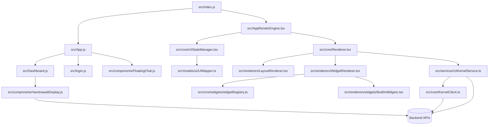

# Vanshawali Frontend Audit Report (Phase 1)

Date: 2026-08-03
Scope: Frontend-only audit for botmantra-ui with strict backend compatibility.
Backend changes: Not included.

## 1) Project Discovery Summary

### Stack
- React 19 + react-scripts
- React Router
- Hybrid architecture:
  - Legacy app flow in src/App.js
  - Kernel-driven render flow in src/AppRenderEngine.tsx and src/core/Renderer.tsx
- Service layer split across src/services/*.js and src/services/*.ts
- Theme token system present in src/themes/tokens with partial adoption

### Key Entry Points
- src/index.js
- src/App.js
- src/AppRenderEngine.tsx
- src/core/UIStateManager.tsx
- src/core/KernelClient.ts
- src/services/UIKernelService.ts

## 2) Dependency Graph (High-Level)

## 3) Duplicate and Overlap Findings

### Architecture-level duplication
- Legacy route/render flow and modern kernel flow coexist.
- Sources:
  - src/App.js
  - src/AppRenderEngine.tsx
  - src/core/Renderer.tsx

### Chat duplication
- src/components/FloatingChat.js
- src/components/FloatingChat.tsx
- src/ui-contract/FloatingChatWidget.js

### Onboarding duplication
- src/components/ProfileOnboarding.js
- src/components/UnifiedOnboardingContainer.tsx
- src/pages/OnboardingFlow.jsx

### Dashboard overlap
- src/Dashboard.js
- src/components/DashboardSelector.js
- src/services/DashboardManagementService.js

## 4) Reusable Widget Inventory

### Existing reusable render widgets
- src/renderers/widgets/BuiltInWidgets.tsx
- src/renderers/widgets/KPIWidget.tsx
- src/renderers/widgets/ActionGridWidget.tsx
- src/renderers/widgets/FloatingChatWidget.tsx

### Reusable core renderer layer
- src/renderers/LayoutRenderer.tsx
- src/renderers/WidgetRenderer.tsx
- src/core/widgets/widgetRegistry.ts
- src/core/widgets/registerDefaultWidgets.ts

### Missing reusable widgets for Vanshawali target scope
- FamilyActivityTimeline widget
- PostsFeed widget
- DravyamWalletSummary widget
- PoseWall widget
- MemberProfileOverview widget
- GlobalSearch widget
- NotificationCenter widget

## 5) API and Service Binding Audit

### Current API clients
- src/core/KernelClient.ts
- src/services/UIKernelService.ts
- src/services/apiService.js
- src/services/AuthService.js
- src/services/AdminService.js
- src/services/DashboardManagementService.js

### Current Vanshawali data binding in component
- src/components/VanshawaliDisplay.js directly calls axios endpoints:
  - /api/vanshawali/user-lineage/:userId
  - /api/vanshawali/family-tree/:familyId
  - /api/vanshawali/statistics

### Service architecture gap
- Some major UI components still call API directly instead of using dedicated service + DTO mapper pipeline.

## 6) State Management Audit

### Global state
- src/core/UIStateManager.tsx manages:
  - uiState
  - permissions
  - loading and error

### Local component state fragmentation
- Heavy local state across src/App.js, src/Dashboard.js, src/login.js, and onboarding modules.

### Permission handling
- Permission-aware logic exists but is mixed across UI context, mapper, and legacy components.

## 7) Theme and Design System Audit

### Strengths
- Token modules implemented under src/themes/tokens
- Theme engine available in src/themes/themeEngine.ts
- Brand registry exists in src/themes/brandRegistry.ts

### Gaps
- Many legacy styles still hardcoded in CSS and inline styles.
- Token adoption is partial and inconsistent.

## 8) Routing and Navigation Audit

### Current visible route set in src/index.js
- /
- /login
- /dashboard
- /dashboard-engine
- wildcard fallback

### Navigation complexity
- Route-level and state-level navigation both exist, causing duplicated behavior paths.

## 9) Localization and Accessibility

### Localization
- No centralized i18n implementation detected.
- Strings are primarily hardcoded in English.

### Accessibility
- Basic improvements in some components (labels, semantic buttons).
- No complete WCAG pass coverage detected.

## 10) Test Coverage Snapshot

### Existing test suites
- src/App.test.js
- src/core/PermissionGuard.test.tsx
- src/models/ui/UIMapper.test.ts
- src/services/UIKernelService.test.ts
- src/renderers/TableRenderer.test.tsx
- src/renderers/widgets/ActionGridWidget.test.tsx
- src/components/widgets/CardWidget.test.js

### Gaps
- No strong integration tests for full Vanshawali dashboard flows.
- Limited coverage for auth-to-dashboard journey and tab-specific data states.

## 11) High-Priority Risks

1. Dual frontend architecture increases maintenance and behavioral drift risk.
2. Direct API calls inside feature components break clean widget-service separation.
3. Incomplete tokenization can produce theme inconsistency.
4. Mixed navigation patterns can create route and state mismatch.

## 12) Phase 2 Readiness

Phase 1 audit is complete.
No backend redesign required.
Recommended next action: execute Phase 2 Screen Inventory as a formal matrix for all requested Vanshawali screens with persona, goal, data source, permission, loading, empty, error, responsive, and accessibility notes.

## 13) Immediate Frontend Refactor Priorities (No Backend Changes)

1. Canonicalize one app shell and one renderer path.
2. Move Vanshawali component API calls into dedicated service + DTO + mapper files.
3. Create widget modules for Family Activity, Posts, Dravyam, Profile, Pose Wall.
4. Normalize all page states (loading, skeleton, empty, error) per widget.
5. Expand route-level and component-level test coverage for primary user journeys.
